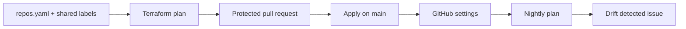

# github-governance

The GitHub settings for this showcase, including this repository, defined as code.
The engineering handbook lives in [the shared .github repo](https://github.com/Abdel-Abdelaal/.github).

## Status

Bootstrap repository protection is active. Terraform code and validation can run
without privileged credentials. **Unattended state/apply/drift automation requires
the owner setup in [docs/setup.md](docs/setup.md)** and is not active until verified. A reviewed, one-time local bootstrap can adopt
the existing resources and activate required checks before that account setup; see
[ADR 0003](docs/decisions/0003-bootstrap-required-checks.md).
Do not interpret a skipped credentials step as a successful plan or apply.

## How it works

`repos.yaml` lists the managed repositories and defaults. `modules/repo` manages
settings, labels, security features and the default-branch ruleset. The labels
are fetched from a pinned revision of the shared handbook; update that revision
through a PR when labels change. This makes plans reproducible.



## Commands

Use Terraform 1.16.5 (or compatible 1.16.x), then:

```sh
terraform fmt -check -recursive
terraform init -backend=false
terraform validate
tflint --init && tflint --recursive      # Terraform linter, config in .tflint.hcl
trivy config --severity HIGH,CRITICAL .  # misconfiguration scan
ruff check . && python -m unittest discover -s tests
# After owner setup, with GITHUB_TOKEN and TF_TOKEN_app_terraform_io in the shell:
terraform init
terraform plan -out=reviewed.tfplan
terraform apply reviewed.tfplan
terraform plan -detailed-exitcode
```

The provider is locked in `.terraform.lock.hcl`. Never commit state, saved plans,
credentials or App private keys. The repository resources have `prevent_destroy`.

## Change and recovery

Change desired settings through a PR, review the plan and merge only once checks
pass. Imports adopt existing repos and rulesets without replacing them. First
apply must be inspected for unexpected deletes or replacements. A second plan
must return exit code 0 before calling bootstrap complete.

Nightly exit code 2 opens/updates `Drift detected`; exit code 0 closes it. Errors
also open an issue and fail the run. All runs share a concurrency lock to prevent
simultaneous mutations. HCP Terraform provides state locking and history.

In an emergency the account owner can change GitHub settings directly. Record the
reason, then reconcile desired state before the next apply. No bypass App is part
of the ruleset. Solo repos require zero approvals because owners cannot approve
their own PRs; a team would require 1–2 approvals and CODEOWNERS review.

## Reports

Two scheduled workflows report on the whole fleet. Each keeps a single issue up to date
and never changes settings:

| Workflow | When | Issue | Reads |
|---|---|---|---|
| [Dependency inventory](.github/workflows/dependency-inventory.yml) | Mondays 06:30 UTC | `Dependency inventory` | every pinned dependency in the fleet (GitHub's dependency graph for Actions, Python and npm, plus pre-commit hooks, Terraform providers and container images), each upstream project's archive status, last push and newest release; JSON copy kept 90 days as an artifact |
| [Fleet health](.github/workflows/fleet-health.yml) | Mondays 06:45 UTC | `Fleet health` | live required checks vs `repos.yaml`, latest run of every workflow on `main`, open `governance` issues, open PRs, public OpenSSF Scorecard score |
| [Access review](.github/workflows/access-review.yml) | 1st of the month 07:00 UTC | `Access review YYYY-MM` | collaborators, deploy keys, Actions secret ages (90-day rotation checkbox), ruleset bypass actors |

Anything the token can't read is shown as `unreadable` or `skipped`, never as healthy.
Until the governance App exists, the access review runs on the workflow token, so the
admin-only sections are reported as skipped. A required check marked "not applied" is
desired state waiting for a Terraform apply. Scheduled failures open
`Governance workflow failed`.

## What this demonstrates

Repository governance as code, self-management, state imports, least-privilege App
identity, drift detection and auditability through PR history.

## Advisory AI maintenance

Same-repository PRs receive an isolated MiMo 2.6 Flash review; fork and Dependabot
PRs skip. Findings are non-blocking summaries and neutral notice annotations.
Weekly audits maintain one health issue. A bounded, tested draft fix PR is possible
only after the automation App is configured; otherwise that step skips explicitly.
No AI check is required for merging, and no AI workflow can merge or approve.
See [the isolation design](https://github.com/Abdel-Abdelaal/platform-workflows/blob/main/docs/ai.md).

The desired label catalog now includes `stale`, `autorelease: pending` and
`autorelease: tagged`, pinned to reviewed handbook commit `3f91a23103c44b27c58f493dfd799e6a442c7056`.
These labels are not applied live yet: migrate the existing bootstrap state to
HCP and configure the governance App before applying. Stale/release maintenance
explicitly skips mutations until its canonical labels exist.

Maintenance callers now pin platform v1.6.0 (`9963dc1ffc49cff752cc62f2ec9c1651bdb3f482`).
Its corrected AI runtime awaits consumer audit verification. Frozen hook checks
run where a hook configuration is supported; native Dependabot maintains baseline
hook revisions. Stale/release mutations remain explicitly gated on canonical
labels and maintenance App setup. The Python audit includes development tooling.
